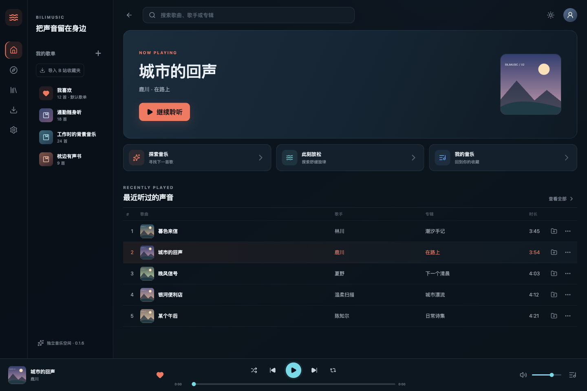

# BiliMusic

收藏喜欢的B站音乐，把有声书和长音频也整理进自己的音乐库。支持 macOS、Windows 与 Android，可选坚果云或 BiliMusic 云同步。

[官网下载](https://bilimusic.cn/#download) · [GitHub Releases](https://github.com/licpp/BiliMusic-Desktop/releases) · [Gitee 国内镜像](https://gitee.com/yoaker/BiliMusic-Desktop/releases) · [反馈](https://bilimusic.cn/#feedback)



*当前客户端界面，截图使用演示曲目和示意封面，不代表软件附带媒体资源。*

- **整理收藏**：导入B站收藏夹，用歌单管理喜欢的音乐、有声书和长音频。
- **歌词与歌曲资料**：匹配歌词并选择合适版本；填写歌名与歌手，一键查找专辑和封面，确认后应用。
- **跨设备同步**：同步歌单、收藏、修改后的歌曲信息和歌词设置，可选最近播放；默认关闭。
- **专注聆听**：队列、循环播放、按需视频与弹幕，让电脑和手机都成为你的音乐空间。

最新版本为 **0.1.9**，支持分类收藏整个分 P 合集，安卓首页集中管理歌单和收藏；从列表选歌时使用完整列表作为播放队列，检查更新支持官网、Gitee、GitHub 依次备用。macOS 使用完整 ad-hoc 签名，尚未 Apple 公证；Windows 尚未发布者签名。Android 直接下载 APK 安装，固定签名支持覆盖上一版。

> 独立开源客户端，非哔哩哔哩官方产品，未获得其官方授权。音视频、歌词与封面等第三方内容的权利归相应权利人所有。MIT 代码许可不包含第三方内容授权。请在适用法律、平台规则和内容授权允许的范围内使用，详见 [使用声明与隐私说明](DISCLAIMER.md)。

## 已实现

- macOS / Windows / Android 客户端；B 站视频搜索、分页、分 P 展开、单独播放及整组加入队列。
- 默认关闭的坚果云 / BiliMusic 云同步，按B站账号隔离资料，首次确认后自动同步个人修改。
- 音频流播放、进度拖动、音量、随机播放、循环模式、上一首与下一首。
- 队列增删、排序、清空、播放全部，重启后恢复队列、位置及播放偏好；恢复时不自动播放。
- 本地音乐库、独立分 P 收藏、最近播放、歌单创建／重命名／删除及歌曲管理。
- 歌曲 metadata 编辑，歌手与 UP 主分开，按歌曲名和歌手查询专辑与封面候选。
- 用户发起歌词搜索并选择版本、歌词时间偏移及持久化；主服务失败时重试并查询备用源，搜索缓存可离线回退，也可粘贴本地 LRC／文本。
- 歌词页按需加载静音视频、跟随音频同步、页面内全屏、弹幕及字号／透明度调整。
- B 站扫码登录、本地会话恢复、评论分页、展开更多回复、回复与点赞。
- 流式音频下载、进度显示、失败重试、下载目录选择、离线优先播放。
- 搜索历史与清除、系统托盘、空格播放／暂停和 Escape 收起歌词。
- 登录后导入 B 站收藏夹为本地歌单，拆分分 P，跳过失效视频并报告错误。
- 通过 WebView Media Session 接入系统媒体按键和播放信息（取决于平台支持）。

导航统一为「此刻、搜索、音乐库、歌单、我的」。音乐库包含「已收藏、最近播放、下载」三个页签；安卓使用底部歌单入口，账号、设置和云同步集中在「我的」。已收藏只聚合已点击红心或加入歌单的歌曲；最近播放保留播放历史。默认歌单「我喜欢」固定在歌单列表首位，不可删除或重命名，加入／移出该歌单与歌曲红心状态使用同一份收藏数据。

## 开发与验证

需要 Node.js 22+、Rust stable，以及对应平台的 Tauri 原生构建环境。

```bash
npm ci
npm run tauri dev
```

`npm run dev` 仅提供浏览器界面预览。平台请求、数据库、下载与登录需要通过原生窗口运行。

```bash
npm test
npm run build
cargo test --manifest-path src-tauri/Cargo.toml
cargo fmt --check --manifest-path src-tauri/Cargo.toml
```

联网提供商测试默认跳过，可用 `cargo test --manifest-path src-tauri/Cargo.toml -- --ignored` 单独执行。它们受平台风控与服务可用性影响，不作为普通 CI 的通过条件。

## 打包

```bash
# 在 macOS 上
npm run tauri build -- --bundles dmg
# 在 Windows 上
npm run tauri build -- --bundles nsis
```

输出位于 `src-tauri/target/release/bundle/`。GitHub Actions 配置在 macOS 和 Windows runner 上分别构建安装包；本地 macOS 构建不能证明 Windows 已通过体验验收。

macOS 使用完整应用包的 ad-hoc 临时签名，并从最终 DMG 验证签名与资源封装。当前仍未配置 Apple Developer ID 签名、Apple 公证、Windows 发布者签名或自动更新；临时签名不能证明发布者身份。正式分发需接入自己的证书与公证流程，证书和账号密钥不要提交到仓库。

## 数据与架构

歌曲以 `bilibili:{bvid}:{cid}` 为身份，修改标题、歌手和封面不会改变收藏、歌单和歌词关联。

- `src/features`：按功能组织界面与状态；播放器为单一音频实例，并防止过期切歌请求覆盖新请求。
- `src/services`：原生命令边界与用户设置。
- `src-tauri/src/domain`：歌曲身份与领域契约。
- `src-tauri/src/infrastructure`：SQLite 仓储、平台提供商和媒体代理。
- `src-tauri/src/interface`：Tauri 命令、输入校验及错误映射。

收藏、metadata、歌单、歌词、历史与下载记录保存到应用数据目录的 SQLite；账号 Cookie 也保存在该本地数据库，尚未接入系统凭据库。Unix 系统限制数据库文件为仅当前用户读写。队列与播放偏好保存在 WebView 本地存储，下载音频保存在用户选择的目录。

媒体由随机令牌保护的本机代理提供，支持 HTTP Range 拖动；离线文件只允许从数据库中的完成下载记录注册。封面模式不会加载视频。

## 当前边界

- 尚未实现 B 站收藏夹双向同步、下载暂停／续传和自动更新。
- Windows 安装及媒体解码、登录后的实际回复／点赞，仍需在对应平台与账号上体验验收。
- 平台接口可能受到风控、账号权限或内容可用性的影响。
- 本项目不附带音乐、封面、视频或歌词内容；第三方内容权利归相应权利人所有。

代码来源约束见 [CLEAN_ROOM.md](CLEAN_ROOM.md)，第三方说明见 [THIRD_PARTY_NOTICES.md](THIRD_PARTY_NOTICES.md)。

## 网站与反馈

网站代码位于 [website](website/README.md)，提供功能介绍、macOS / Windows 安装包下载、下载前声明确认及无需 GitHub 账号的站内反馈。国内优先推荐 [Gitee 发行版](https://gitee.com/yoaker/BiliMusic-Desktop/releases/tag/v0.1.6)，同时提供 [GitHub Releases](https://github.com/licpp/BiliMusic-Desktop/releases/tag/v0.1.6)。Android 显示 Coming soon。

0.1.9 支持以下平台：macOS 安装包支持 macOS 12+ 与 Apple Silicon（暂不包含 Intel Mac），Windows 安装包为 x64。macOS 使用临时签名，尚未 Apple 公证；Windows 尚未发布者签名。下载时请核对来源与发行版附件中的 SHA-256 校验清单。两边安装包来自同一次成功的 GitHub Actions 构建，文件内容一致。

反馈保存在独立 PostgreSQL 数据库，包含错误反馈、功能建议和权利人反馈。请通过 [网站表单](https://bilimusic.cn/#feedback) 联系维护者，并勿提交密码、Cookie、完整私人日志等敏感信息。

后续自有服务器同步与坚果云等 WebDAV 扩展的设计边界见 [云同步扩展约定](docs/CLOUD_SYNC_DESIGN.md)。当前尚未开启用户音乐数据上传。

## Android 支持

新增 Android 8.0+ ARM64 适配，包含手机界面、原生后台音频服务、锁屏/通知控制及应用私有目录离线下载。与桌面共用搜索、分 P、歌单、metadata、歌词、视频和评论后端。详细环境配置、构建命令和真机体验注意事项见 [Android 说明](docs/ANDROID.md)。

`android-build` 工作流使用固定签名，可覆盖之前相同签名的版本；官网已提供三端安装包。Android 使用优化后的 Release 构建，并保留原生播放与安全存储插件的反射入口。

### Android 包体积

Android 发行构建使用 Release 模式，Rust 启用符号裁剪、thin LTO 和尺寸优化；继续使用固定签名以支持覆盖安装。CI 检查最终 APK 的原生库体积及播放插件类保留情况，避免误发包含调试符号的包。展开多分P只展示曲目，明确点击曲目或“播放全部”才会播放。

### 检查更新

在「我的 → 应用更新」手动检查官网当前发布版本，支持 Android ARM64、macOS Apple Silicon 和 Windows x64。检查到新版本后可通过系统浏览器前往官网下载页，保留 Gitee / GitHub 双源和下载声明；不会自动下载安装。网络失败可重试，不影响播放。`package.json`、Tauri 配置、Cargo 和官网清单使用相同的数字版本号，Android 还需递增 versionCode。
