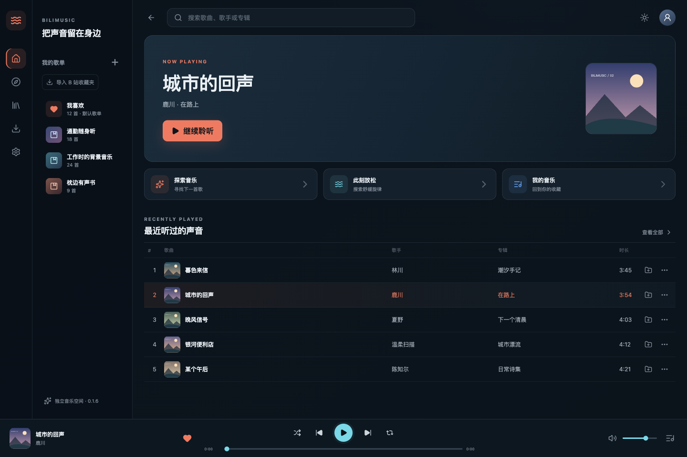

<p align="center">
  
</p>

<h1 align="center">BiliMusic</h1>

<p align="center">
  让 B 站成为你的音乐库。<br>
  音乐、有声书与长音频，在电脑、手机和大屏之间延续。
</p>

<p align="center">
  <a href="https://github.com/licpp/BiliMusic-Desktop/releases"></a>
  <a href="LICENSE"></a>
  <a href="https://bilimusic.cn"></a>
</p>

<p align="center">
  <a href="#下载">下载安装</a> ·
  <a href="#功能">功能介绍</a> ·
  <a href="https://bilimusic.cn/#changelog">更新日志</a> ·
  <a href="https://github.com/licpp/BiliMusic-Desktop/issues">问题反馈</a>
</p>



## 下载

[**官网下载**](https://bilimusic.cn/#download) · [**GitHub Releases**](https://github.com/licpp/BiliMusic-Desktop/releases) · [**Gitee 国内镜像**](https://gitee.com/yoaker/BiliMusic-Desktop/releases)

| 平台 | 安装包 | 系统与架构 |
| --- | --- | --- |
| macOS | DMG | macOS 12+ · Apple Silicon / Intel |
| Windows | 安装程序 | Windows 10 / 11 · x64 / ARM64 |
| Android 手机 / 平板 | APK | Android 8+ · ARM64 |
| iOS / iPadOS | 自签 IPA | iOS / iPadOS 15+ · ARM64 |
| HarmonyOS NEXT | 未签名 HAP 测试包 | HarmonyOS 6.0+ · ARM64 |
| 车机 / TV | 独立大屏 APK | Android 8+ · ARM64 / ARMv7（32 位）· 触控 / 遥控器 |
| Linux（测试版） | AppImage / DEB | x64 / ARM64 · 尚未经过完整实机测试 |

[iOS 自签安装](https://bilimusic.cn/ios.html) · [鸿蒙签名与安装](https://bilimusic.cn/harmony.html)

**0.3.6 已发布**：新增可选响度均衡、合集分类与内容隐藏，改进歌单匹配、歌词与长音视频播放。[查看完整更新记录](https://github.com/licpp/BiliMusic-Desktop/releases/tag/v0.3.6)。

## 功能

- **整理自己的音乐库**：搜索 B 站视频与 UP 主，用歌单、收藏和文件夹收好喜欢的内容。电脑端提供画廊视图，支持拖动整理与多选操作。
- **带上已有歌单**：粘贴网易云、QQ 音乐、酷狗、酷我、咪咕的歌单链接，或导入歌曲列表，自动匹配 B 站视频。支持重试未匹配歌曲、搜索和更换视频，保留原歌单顺序。
- **补全歌曲资料与歌词**：支持批量自动匹配，手动选择过的结果会保留。逐字歌词、翻译、音译和 B 站字幕按需切换，也可通过 AI 字幕自动校准歌词偏移。
- **长内容按章节听**：浏览合集分类，展开分 P，隐藏暂时不想听的 BV 或分 P。合集续播会定位上次内容及所属分类，是否恢复时间进度由续播设置决定。
- **按自己的习惯播放**：队列排序、随机播放、音质切换、离线下载、倍速与断点续播；可选响度均衡，减少不同视频的音量落差。视频、弹幕和全屏播放按需打开。
- **在设备之间延续**：主动连接坚果云后，按需同步歌单、收藏、歌曲修改、歌词设置和播放记录，汇总同一账号的听歌时长、常听歌曲与热力日历。云同步默认关闭，BiliMusic 云暂未开放。
- **适合不同的屏幕**：电脑提供桌面歌词、迷你播放器与自定义快捷键；手机和平板支持后台播放与系统媒体控制；车机 / TV 使用独立的大屏界面，兼顾触控和遥控器操作。
- **在应用内更新**：macOS、Windows、Android 手机 / 平板和大屏版支持检查与下载安装更新；iOS 与鸿蒙提供安装包下载入口。

## 使用声明

> 仅用于学习和测试，请于下载后24小时内删除。不提供任何破解内容。

BiliMusic 是独立开源项目，与哔哩哔哩及其他内容平台无隶属、合作或官方授权关系。

- 项目不内置、托管或销售音视频、歌词及封面等媒体资源；相关内容通过第三方服务获取，权利归相应权利人所有。
- 不提供破解服务，不提供绕过会员、付费、地区或其他访问限制的功能。接口可访问不代表取得平台或内容授权。
- 请在适用法律、平台规则与授权允许的范围内使用，未经许可不得复制、传播或用于商业用途。MIT 许可仅适用于本项目代码，不授予第三方内容使用权。
- 如涉及版权或其他权利问题，请通过[版权反馈入口](https://bilimusic.cn/#feedback)联系维护者；公开 Issue 中请勿提交私人资料。

完整内容见[使用声明与隐私说明](DISCLAIMER.md)。请支持原创与正版。

## 开发与贡献

BiliMusic 使用 **React、TypeScript、Rust、Tauri 与 SQLite**，各端共享业务逻辑，分别对接系统播放器和桌面能力。

```sh
npm ci
npm run tauri dev
```

各平台环境、构建和测试步骤见 [开发指南](docs/DEVELOPMENT.md)。欢迎提交 [Issue](https://github.com/licpp/BiliMusic-Desktop/issues) 与 [Pull Request](https://github.com/licpp/BiliMusic-Desktop/pulls)。

## 开源许可

采用 [MIT License](LICENSE)。第三方代码与依赖见 [THIRD_PARTY_NOTICES.md](THIRD_PARTY_NOTICES.md)。

BiliMusic 是独立开源项目，与哔哩哔哩无隶属关系。[使用声明](DISCLAIMER.md) · [代码来源说明](CLEAN_ROOM.md)
